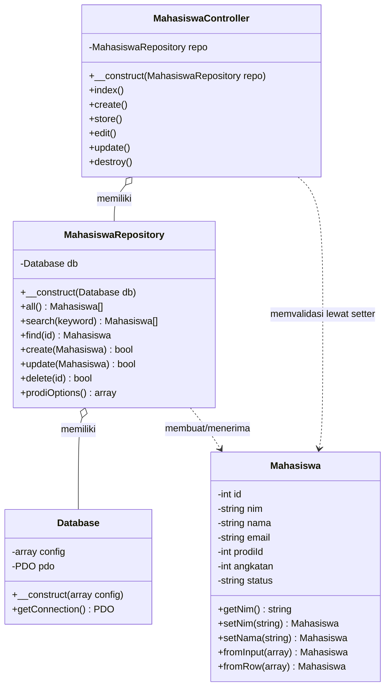

# SI Akademik - Acara 9 (OOP MVC Lanjutan: Object, Dependency, Getter Setter)

URL: `http://localhost/si_akademik/<nama folder>/public/login`
(login: isi username & password apa saja, tidak boleh kosong)

## Pemetaan ke tugas Acara 9 (PDF BKPM)

| No | Tugas                                                                 | Lokasi                                              |
|----|-----------------------------------------------------------------------|-----------------------------------------------------|
| 1  | Class `Database` pengelola koneksi PDO                                | `app/Core/Database.php`                             |
| 2  | `MahasiswaRepository` menerima `Database` via constructor (CRUD)      | `app/Repositories/MahasiswaRepository.php`          |
| 3  | `MahasiswaController` menerima `MahasiswaRepository` via constructor  | `app/Controllers/MahasiswaController.php`           |
| 4  | Atribut `Mahasiswa` private + getter/setter                           | `app/Models/Mahasiswa.php`                          |
| 5  | Validasi di setter (nama tidak kosong, NIM angka)                     | `setNama()`, `setNim()` di `Mahasiswa.php`          |
| 6  | Tambah, ubah, tampil, hapus tetap berjalan setelah refactor           | `routes/web.php` + `app/Views/mahasiswa/*`          |

Perakitan dependency (Dependency Injection) ada di `public/index.php`:
`Database -> MahasiswaRepository -> MahasiswaController`.

## Diagram kelas (untuk laporan)

## Checklist uji manual (screenshot untuk laporan)

1. Login berhasil -> dashboard.
2. Tambah mahasiswa valid -> muncul di daftar + pesan sukses.
3. Tambah dengan NIM berisi huruf -> ditolak, pesan "NIM harus berupa angka".
4. Tambah dengan nama kosong (spasi saja) -> ditolak, pesan "Nama ... tidak boleh kosong".
5. Edit data -> tersimpan.
6. Hapus data -> muncul konfirmasi, lalu data hilang.
7. Cari berdasarkan NIM/nama -> hasil terfilter.

## Log Git (untuk laporan, sesuai rubrik)

    git add .
    git commit -m "Acara 9: refactor ke Repository, DI, getter/setter"
    git log --oneline
